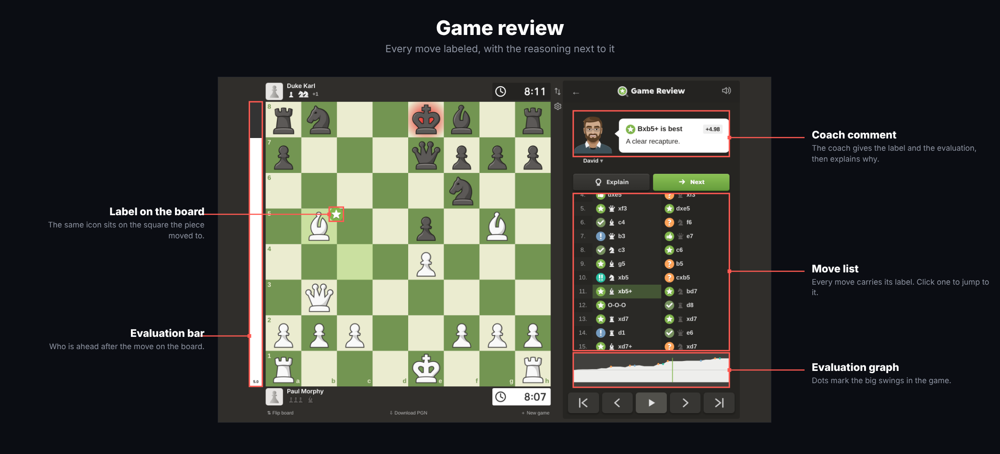
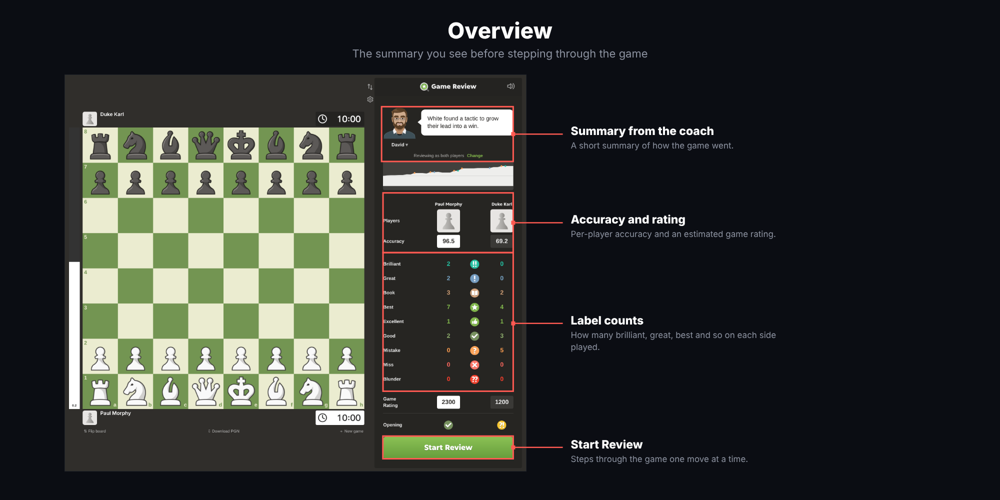
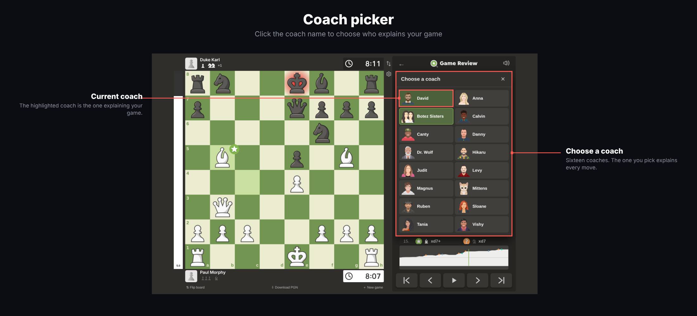
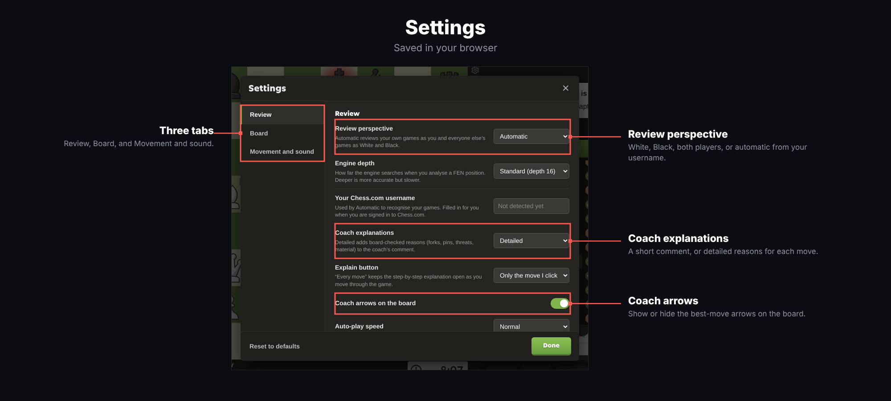

# pixel's game review

A Chrome extension that reviews finished Chess.com games with a local engine. It labels every move, scores accuracy for both sides, estimates a game rating, and has a coach explain what happened. Reviews run on your machine and are saved in the browser.

## Install

1. Open `chrome://extensions` and switch on Developer mode.
2. Choose Load unpacked and select this folder.
3. After changing any file, press the reload button on the extension card.

## Use

When a Chess.com game ends, click Review with pixel on the game page. The extension button also opens an import page where you can paste a PGN or a Chess.com game link. A link only works if the game is in Chess.com's public archive. If the lookup is blocked, paste the PGN instead.

The overview shows accuracy, label counts and the evaluation graph. Start Review steps through the game with the coach comment beside every move. Explain breaks the selected move down, and Best shows why the engine's move is stronger than the one played.

## Perspective

With Review perspective set to Automatic, the extension compares the players with your Chess.com username. It picks the username up while you are signed in, or you can type it in Settings. Your own games are reviewed from your side and the board turns to your color. Everyone else's games are explained as White and Black. You can also force White, Black or both players, and the comments are rewritten without running the review again.

## Exploring lines

Drag a piece, or click it and then a target square. You can play from any position, including after Best, and every move you explore is analyzed and added to the move list as a side line. Follow-up plays out the engine's continuation, the arrow keys move through the current line, and Resume goes back to the recorded game. Explored lines never change the saved game. Right-drag draws arrows.

## Settings

The gear under the flip icon opens Settings. It covers perspective, username, how detailed the coach is, when Explain opens, coach arrows, auto-play speed, your Chess.com board, pieces and background, coordinates, last move highlight, legal moves, board icons, the evaluation bar, captured pieces, animations and move sounds.

## Folders

| Folder | What it is |
| --- | --- |
| `review/` | The review page: board, coach panel, settings, and the runtime that drives them. This is the part you see. |
| `engine/` | The local analysis engine (`explanation-engine.js` and its 26 MB `.wasm`). Chess.com's own, loaded as a web worker. |
| `icons/` | Extension icons and the move label icons. |
| `docs/` | The screenshots used in this README. |
| `study/` | The deobfuscated runtime, for reading only. `runtime.readable.js` is `review/runtime.js` with its string table and renamed identifiers restored, and `deob.cjs` is the script that produced it. It is not part of the extension and nothing loads it. |
| `tmp/` | Scratch space from taking the extension apart: small decoding scripts and extracted assets. Nothing loads these either. |

`background.js`, `content.js` and `page-context.js` in the root are the extension's service worker and the scripts that run on Chess.com pages.

## Notes

Scores, accuracy, labels and ratings are local estimates and do not reproduce Chess.com's hosted analysis.
